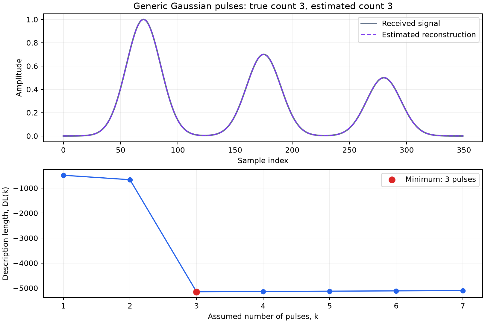

# Pulse Count Estimation

Generic Python implementation of the supplied MATLAB MDL calculation, using matched filtering for pulse-delay estimation.

```bash
python3 -m venv .venv
source .venv/bin/activate
pip install -r requirements.txt
python demo.py
```

Tested with Python 3.14. Edit the settings at the top of `demo.py` to change pulse count, spacing, amplitudes, or noise. Start noiseless, then try `NOISE_STD = 0.03`.



The score uses the same penalty coefficient as the MATLAB implementation, while the paper uses half that value. A small numerical floor is applied to avoid issues with perfect, noiseless fits. Because this approach relies on a simple matched filter, it may struggle to distinguish overlapping pulses.
