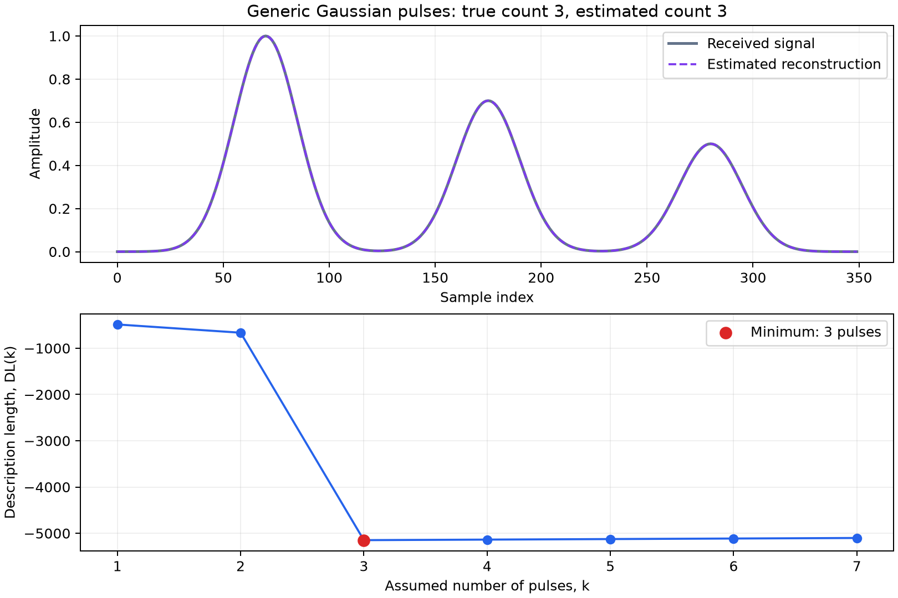
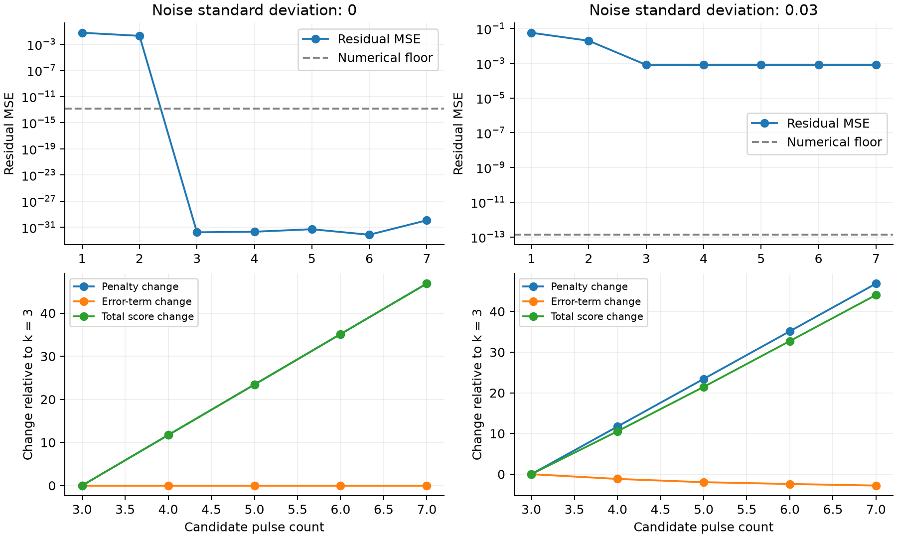
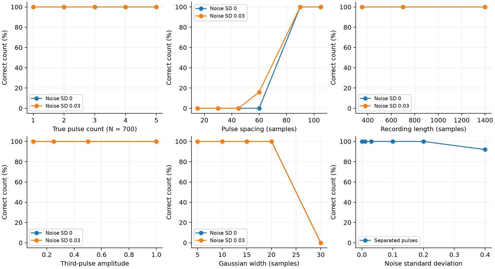
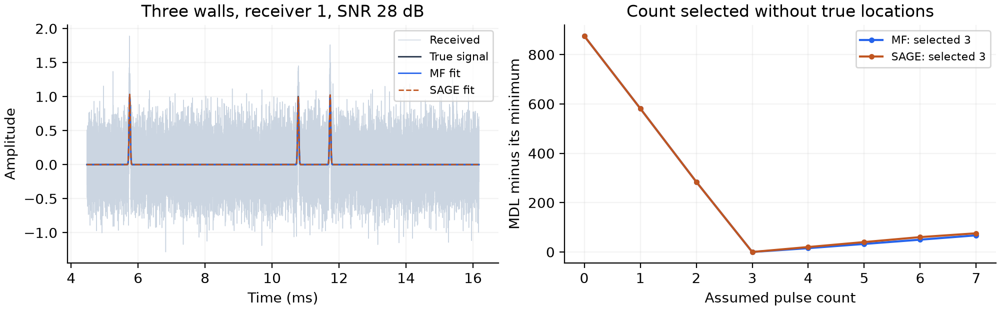
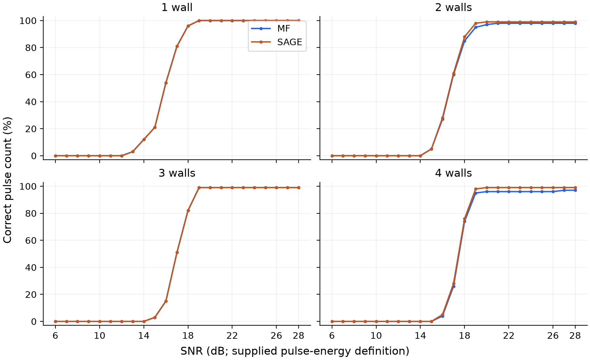

# Pulse Count Estimation

Generic Python implementation of the supplied MATLAB MDL calculation, using matched filtering for pulse-delay estimation.

```bash
python3 -m venv .venv
source .venv/bin/activate
pip install -r requirements.txt
python demo.py
```

Tested with Python 3.14. Edit the settings at the top of `demo.py` to change pulse count, spacing, amplitudes, or noise. Start noiseless, then try `NOISE_STD = 0.03`.



The score uses the same penalty coefficient as the MATLAB implementation, while the paper uses half that value. A small numerical floor is applied to avoid issues with perfect, noiseless fits. Because this approach relies on a simple matched filter, it may struggle to distinguish overlapping pulses.

## Follow-up experiments

Run `python investigate.py` to separate residual error from the MDL penalty and vary pulse count, spacing, recording length, amplitudes, width, and noise. Each noisy setting uses 100 realizations; noiseless settings use one deterministic test. Raw results are in [`results/`](results/).

The small rise after three pulses is explained by the penalty and numerical floor. Close overlap exposes a limitation of the fixed-location matched filter.





## Project simulation

[One-page report](output/pdf/project_mdl_report.pdf)

Place Michael's supplied `mdl_sim_setup.py` in `private/` (excluded from Git), then run:

```bash
pip install -r requirements.txt
OPENBLAS_NUM_THREADS=1 python project_mdl.py --validate
OPENBLAS_NUM_THREADS=1 python project_mdl.py --trials 20 --workers 4
python plot_project.py
```

Tests 1–4 walls, five receivers, and SNR 6–28 dB using the supplied simulation's SNR definition. Each wall count uses 20 random environments, reused across SNR levels with the same standardized noise. Both fitting methods see identical signals. MDL selects among 0–7 pulses; zero allows a noise-only result. The penalty matches the MATLAB implementation. Each receiver is scored separately; there is no receiver voting.

SAGE uses cached correlations for speed, checked against the supplied implementation on separated and overlapping examples. Its initialization, update rule, iteration limit, and tolerance are unchanged. Results describe these supplied fitting methods, not globally optimal pulse fits.

Raw counts and scores are in [trials.json](results/project/trials.json); averages are in [summary.csv](results/project/summary.csv). The five receivers in an environment are related, so 100 receiver results per setting represent 20 independent environments.

At 20 dB, accuracy averaged across wall counts was 98% for MF and 99.25% for SAGE. At 6 dB, both methods always counted too few pulses in these trials.




